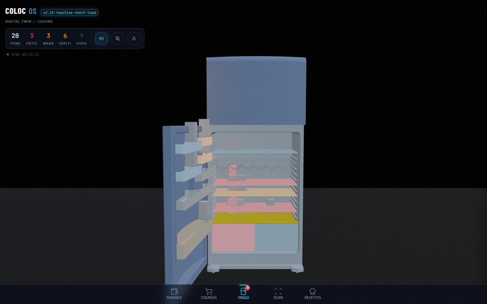
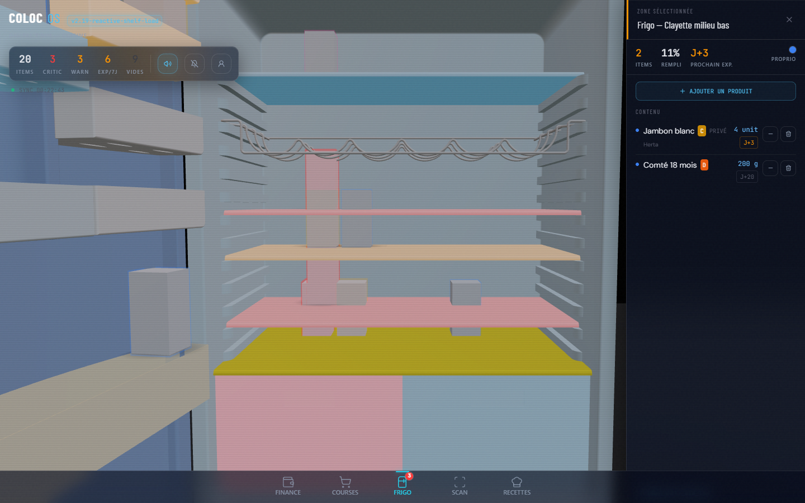
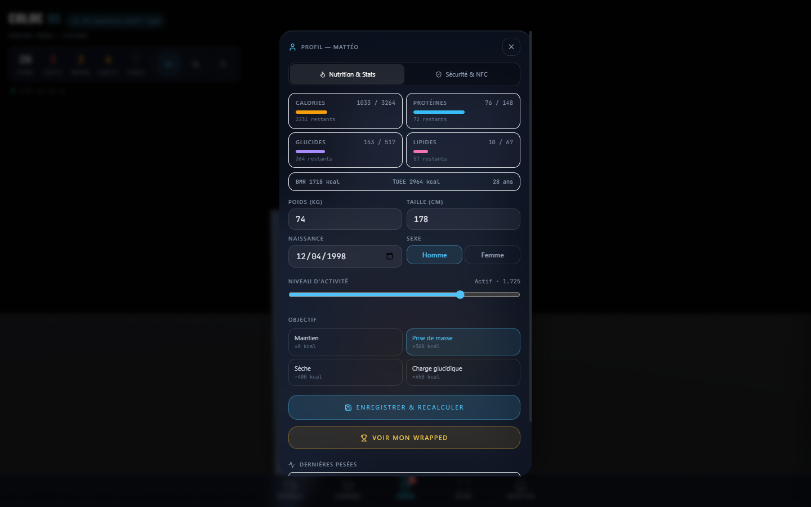
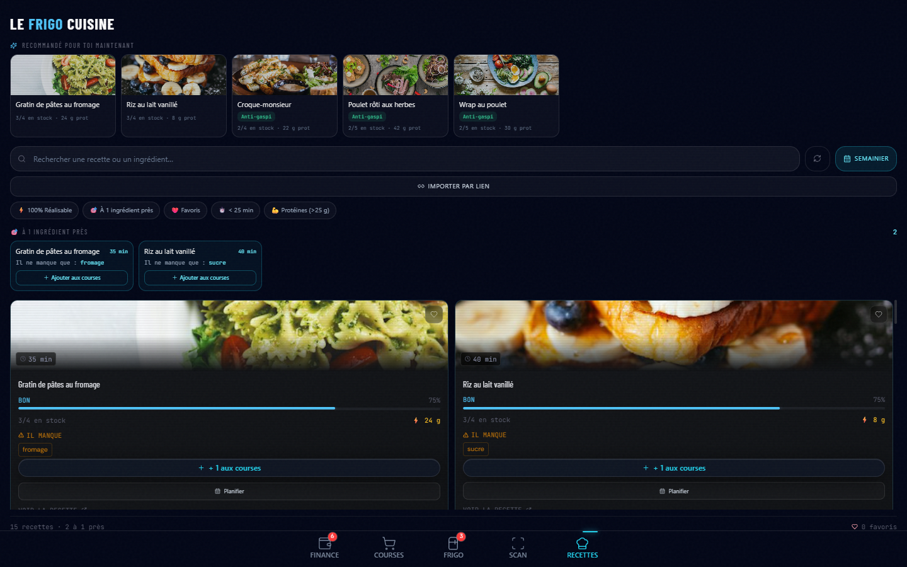
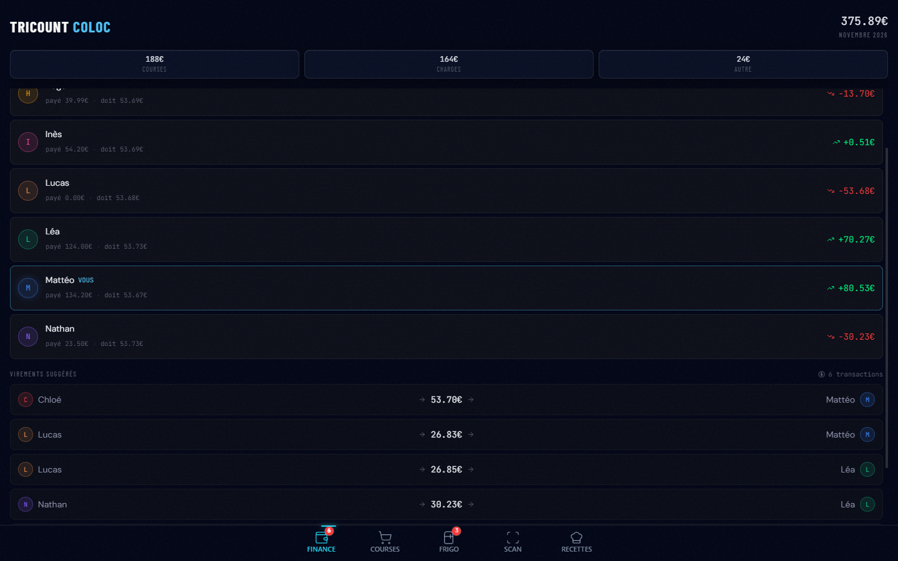
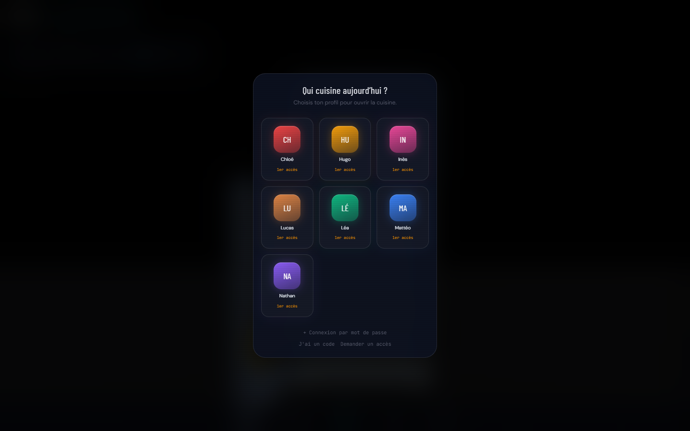

# ColocOS 🧊

**A 3D digital twin of your shared flat — fridge, pantry, meal planning, nutrition and shared money in one place.**

ColocOS started from a simple annoyance: in a shared flat, nobody knows what is in the fridge, who paid for what, or what is about to expire. It answers those three questions with a **live 3D model of the kitchen**, a barcode scanner, a nutrition engine and a settlement ledger.

> **En bref (FR)** — ColocOS est un « jumeau numérique » de la cuisine d'une coloc : un frigo 3D interactif synchronisé avec un inventaire réel (scan code-barres, DLC, quantités), doublé d'un suivi nutritionnel (BMR/TDEE, macros), d'un tricount avec virements suggérés, d'un planning de repas et d'une inscription sur approbation par email. Monorepo TypeScript, PostgreSQL + Prisma, déployé avec Docker et Caddy.



---

## Table of contents

- [What it does](#what-it-does)
- [Screenshots](#screenshots)
- [Architecture](#architecture)
- [Getting started](#getting-started)
  - [Docker (one command)](#docker-one-command)
  - [Local development](#local-development)
  - [Demo data](#demo-data)
- [Configuration](#configuration)
- [The invitation flow](#the-invitation-flow)
- [BLE scale bridge](#ble-scale-bridge)
- [Project layout](#project-layout)
- [Engineering notes](#engineering-notes)
- [Status & limitations](#status--limitations)

---

## What it does

### 🧊 Interactive 3D kitchen twin
The kitchen is a CAD model (exported from Onshape) rendered with **React Three Fiber**. Every shelf, door bin, crisper and freezer drawer is a clickable *storage zone* mapped to a database row. Opening the fridge door, diving into a crisper or clicking a product triggers a purpose-built camera framing — the whole navigation was tuned for a phone held in one hand.

### 📦 Stock, expiry dates and partial consumption
Products are scanned with a custom [ZXing](https://github.com/zxing-js/library)-based engine (the native `BarcodeDetector` cannot decode 1D codes on iOS), looked up in a product catalogue, then placed in a zone. Consumption is a **soft delete** (`consumedAt`), so history survives: a product can be finished, reduced by a dose or by 25 %, or reported as wasted. The HUD tracks total items, items close to expiry, and waste over 7 days.



### 🥗 Nutrition and meal planning
Each roommate has a profile (height, weight, birth date, activity level, goal). Daily targets are computed **server-side** with Mifflin-St Jeor × activity factor, adjusted by goal (+300 kcal bulk, −400 cut, +450 carb-load) and split into protein / fat / carbs. Meals built from scanned products are stored server-side, and shared meals split macros across participants — and can generate the matching shared expense.



Recipes are ranked against what is actually in the fridge: ingredient coverage, expiry pressure, and how well the macros match what is left in the day.



### 💸 Shared money, settled automatically
Every expense is split between roommates; the balance screen shows who overpaid and who owes, and proposes the **minimum set of transfers** to settle everything.



### 🔐 Profiles, PINs and admin-approved invitations
Shared-tablet first, but safe on the open internet:

- **Trusted devices.** A browser is enrolled for an account only after a strong sign-in (email + password, or sign-up with an invitation code). It receives an `HttpOnly; Secure; SameSite=Lax` cookie whose secret is stored **hashed** (SHA-256) in `trusted_devices`. One browser can hold several accounts, so a kitchen tablet serves the whole flat.
- **PIN as a second factor.** In production the profile picker only lists accounts enrolled on *this* browser, and `POST /auth/login-pin` is rejected before the PIN is even checked when the device is unknown. A stranger opening the site sees no names, only a sign-in form.
- **PIN chosen at sign-up**, hashed with bcrypt; trivial codes (`0000`, `1234`, years) are refused.
- **Device management.** Each roommate can list and revoke their enrolled devices (lost phone).
- **Invitations.** New roommates request access from the login screen; an administrator receives an email (Resend) with an approval link that mails back a single-use code bound to their address.
- A magic **NFC link** can also open a session when a phone taps a badge.



---

## Architecture

```
              ┌───────────────────────────────┐
              │ React 18 + Vite + TypeScript  │
   Browser ──▶│ R3F / Three.js · Zustand      │
              │ Tailwind CSS · PWA            │
              └───────────────┬───────────────┘
                              │  /api (same-origin proxy)
              ┌───────────────▼───────────────┐
              │ Caddy (TLS, headers, static)  │
              └───────────────┬───────────────┘
                              │
              ┌───────────────▼───────────────┐
              │ Express + TypeScript          │
              │ controllers → services        │
              │ Prisma · Zod · JWT · limits   │
              └───────────────┬───────────────┘
                              │
        ┌─────────────────────┼──────────────────────┐
        │                     │                      │
 ┌──────▼───────┐    ┌────────▼────────┐    ┌────────▼─────────┐
 │ PostgreSQL 16│    │ Redis (cache)   │    │ External services │
 │ Prisma ORM   │    │                 │    │ Resend · OFF · BLE│
 └──────────────┘    └─────────────────┘    └──────────────────┘
```

| Layer | Technology |
|---|---|
| Frontend | React 18, TypeScript, Vite 6, Three.js + React Three Fiber + drei, Tailwind CSS, Zustand, framer-motion |
| Backend | Node.js 22, Express 4, TypeScript, Zod validation, JWT, express-rate-limit |
| Data | PostgreSQL 16, Prisma 5 (migrations committed) |
| Infra | Docker Compose, Caddy (TLS + security headers), optional Cloudflare Tunnel |
| Hardware | BLE bridge for the Xiaomi Mi Body Composition Scale 2 (Python `bleak`, or ESPHome) |

**Design rules the code actually follows**

- **Domain logic is pure.** Nutrition targets (Mifflin-St Jeor, BIA impedance equations) live in plain functions that can be tested without a database.
- **The server owns the numbers.** Macro totals, expense splits and daily targets are computed server-side — never trusted from the client.
- **Uniform responses:** `{ success: true, data: … }`, with DTOs validated by Zod.
- **Machine-to-machine calls use dedicated headers.** The scale authenticates with `X-Device-Key`, the training-app bridge with `X-Integration-Key`; neither can carry a user JWT.

---

## Getting started

### Prerequisites

- Node.js ≥ 20 (developed on 22)
- Docker + Docker Compose (for the one-command path)

### Docker (one command)

```bash
cp .env.docker.example .env
# Replace every placeholder (openssl rand -hex 32): compose refuses to start without them

docker compose up -d --build
```

| URL | Service |
|---|---|
| `http://localhost` | Web app (Caddy) |
| `http://localhost/api/health` | API health check |
| `http://localhost:5050` | pgAdmin (optional profile) |

The API container applies migrations at boot (`prisma migrate deploy`): a fresh volume is fully bootstrapped, no manual SQL.

### Local development

```bash
npm ci

# 1. Database
docker run -d --name colocos_db -p 5432:5432 \
  -e POSTGRES_USER=colocos -e POSTGRES_PASSWORD=colocos \
  -e POSTGRES_DB=colocos_db postgres:16-alpine

# 2. Environment
cp apps/backend/.env.example apps/backend/.env

# 3. Schema + demo data
cd apps/backend
npx prisma migrate deploy
npm run db:seed
cd ../..

# 4. Run both workspaces (API on :3001, Vite on :5173)
npm run dev
```

`npm run db:seed` **resets** the database and creates seven fictional roommates (password `coloc2026`). Never run it against real data.

### Demo data

```bash
node demo/populate.mjs   # 20 products, 6 expenses, 6 shopping items,
                         # an athlete profile, weigh-ins and today's meals
```

`demo/backend.env.demo` and `demo/start-demo.ps1` provide a self-contained, credential-free demo: no external API key is required, and emails are logged to the server console instead of being sent.

---

## Configuration

Everything below is optional unless marked. See `apps/backend/.env.example`.

| Variable | Default | Purpose |
|---|---|---|
| `DATABASE_URL` | — | PostgreSQL connection string (**required**) |
| `JWT_SECRET` / `JWT_REFRESH_SECRET` | — | Token signing (**required**, ≥ 32 chars) |
| `PORT` | `3001` | API port |
| `FRONTEND_URL` | `http://localhost:5173` | Public origin, also used for CORS |
| `INVITE_CODE` | empty | Master invitation code (**required in production**; empty = open registration, local demo only) |
| `TERMINAL_SECRET` | empty | `X-Terminal-Secret` of the NFC payment terminal (**required in production**) |
| `RESEND_API_KEY` | empty | Resend API key. **Without it, invitation emails are logged to the console** |
| `MAIL_FROM` | `ColocOS <noreply@example.com>` | Verified sender address |
| `ADMIN_EMAIL` | empty | Recipient of access requests |
| `SCALE_DEVICE_KEY` | dev value | Shared secret for the BLE scale bridge (must be changed in production) |
| `JARVIS_INTEGRATION_KEY` | dev value | Shared secret for the training-app bridge (must be changed in production) |
| `VAPID_PUBLIC_KEY` / `VAPID_PRIVATE_KEY` | empty | Web Push (expiry notifications) |

Secrets are validated with Zod at boot, and the API refuses to start in production with the example values.

---

## The invitation flow

```
Visitor                        API                       Administrator
   │  POST /auth/request-invite  │                            │
   ├────────────────────────────▶│ InviteRequest (PENDING)    │
   │                             ├── email ──────────────────▶│
   │                             │   GET /auth/approve-invite?token=…
   │                             │◀── POST (anti-prefetch) ───┤
   │                             │   POST /auth/approve-invite
   │                             ├── email with COLOC-XXXX ──▶│ → visitor
   │  POST /auth/register        │                            │
   ├────────────────────────────▶│ code + matching email → USED
```

- The **GET** endpoint only renders a confirmation form, so mail scanners that preload links cannot approve a request.
- The invitation code is bound to the requested **email address** and expires after 48 h.
- Registration accepts either the legacy `INVITE_CODE` or an `APPROVED` request; using a request consumes it **in the same transaction** as the user creation.
- `POST /auth/request-invite` always returns the same generic message, so the endpoint cannot be used to enumerate accounts.

---

## BLE scale bridge

`scripts/ble-scale/` contains a small Python gateway (`bleak` + `httpx`) for the Xiaomi Mi Body Composition Scale 2 (`XMTZC05HM`):

- decodes the 13-byte `0x181B` advertising payload (stabilised flag, impedance, weight, unit),
- debounces duplicate frames (60 s cooldown per measurement),
- authenticates with `X-Device-Key` and posts to `/api/profile/weigh-in`,
- runs on a Raspberry Pi 4 (systemd unit provided) or an ESP32 (`esphome-scale.yaml`),
- ships a `--simulate 74.0 480` mode to exercise the whole chain without a physical scale.

Body composition uses the manufacturer's impedance equation (with a physiological range guard), not a generic formula.

---

## Project layout

```
apps/
  backend/          Express API — controllers, services, Prisma schema & migrations
  frontend/         React SPA — R3F scene, Liquid-Glass UI kit, PWA assets
demo/               demo environment, seed population script
scripts/ble-scale/  BLE gateway, ESPHome config, systemd unit
docs/screenshots/   images used in this README
Caddyfile           reverse proxy, TLS and security headers
docker-compose.yml  db, backend, web, tunnel, pgadmin, redis
```

---

## Engineering notes

- **Migrations are the source of truth.** `prisma migrate deploy` bootstraps an empty database; the migration history was reconciled so no column is added behind its back by `db push`.
- **Deliberate soft deletes.** Products and their stock events stay in the database after consumption; imports and integrations are idempotent (`externalId`).
- **No native barcode dependency.** The scanner falls back to a bundled ZXing path because iOS does not expose 1D decoding through `BarcodeDetector`.
- **Rate limiting per surface.** Login/PIN endpoints, registration and access requests each have their own window and threshold.
- **Same-origin API.** The SPA calls `/api` through a proxy, so the app behaves identically on `localhost`, on a LAN IP or behind a tunnel — and generated links never hardcode `localhost`.

---

## Status & limitations

ColocOS is a **personal project**, published as a portfolio piece. It is fully functional but not a commercial product:

- The 3D model is a one-off CAD export; there is no upload pipeline for other kitchens.
- Products come from a public food database (Open Food Facts); the offline fallback catalogue is intentionally small.
- Web Push is implemented (VAPID + daily cron) but notification action buttons are only verified on Android/desktop.
- The nutrition and body-composition formulas follow public references; they are **not medical advice**.
- French is the primary UI language; the API itself is language-neutral.

Ideas next: multi-kitchen support, receipt OCR for expenses, an offline-first scanning queue, and recipe import from a URL.

---

## Credits

Built with React Three Fiber, Prisma, Express and Caddy. Food data by [Open Food Facts](https://world.openfoodfacts.org/). Icons by [lucide](https://lucide.dev/).
